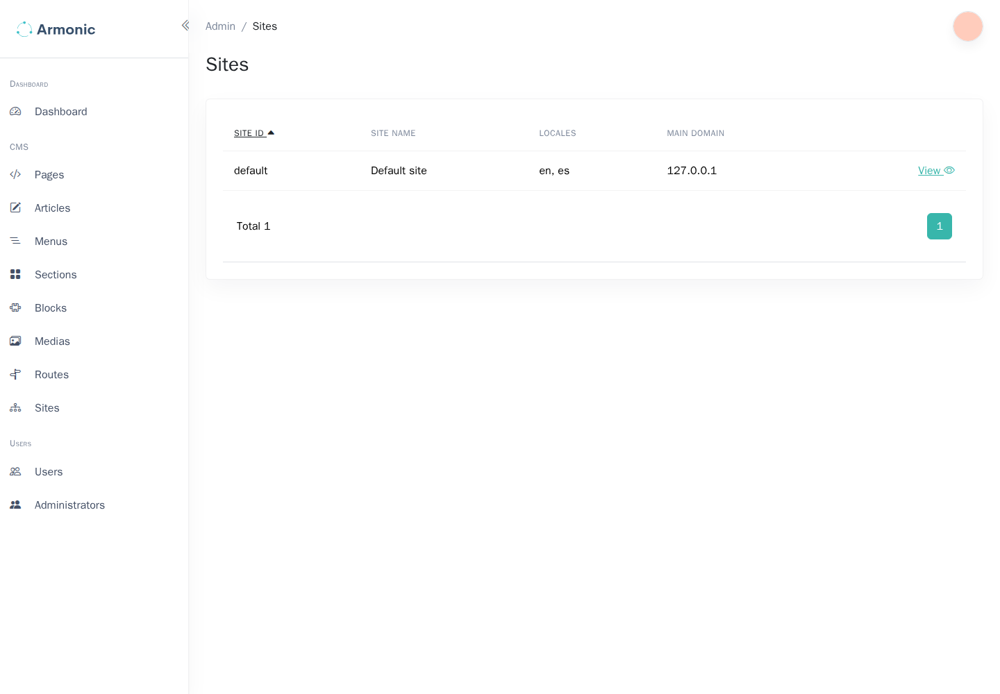

# Configure sites {#configure-sites}

A site groups content, languages, and public URLs. One Symfony application can serve several sites, each with its own hosts, locale paths, and allowed content types.

Create a directory per site under `cms/sites/`. For example, `cms/sites/default/config.yaml` defines the `default` site. The admin area shows the sites loaded from these definitions.

{.img-fluid}

## Start with a local site {#local-site}

This complete configuration serves English content below `/en/` and disables HTTPS redirection for a local HTTP server:

```yaml
# cms/sites/default/config.yaml
site:
    allowed_content_types: ['page']
    locales: ['en']
    default_locale: en
    https_redirect: false
    paths:
        - { path: '/en/', locale: en, trailing_slash_on_root: true }
```

At least one host or path is required for an enabled site. A site's paths and locales determine where its CMS routes are available. Creating a site definition does not create a homepage: create and publish a page, then assign it a CMS route.

Clear the cache after adding or changing a definition:

```bash
php bin/console cache:clear
```

Check the site in the admin area and open one of its published routes. See [Create routes](../user-manual/create-routes.md).

## Add a second language {#locales-languages}

Update the existing site's `locales`, `default_locale`, and `paths` together:

```yaml
site:
    allowed_content_types: ['page']
    locales: ['en', 'es']
    default_locale: en
    https_redirect: false
    paths:
        - { path: '/en/', locale: en, trailing_slash_on_root: true }
        - { path: '/es/', locale: es, trailing_slash_on_root: true }
```

Editors can then provide content for both locales. A locale path does not translate the content automatically; review the translated fields and route paths before publishing.

## Configure public hosts {#host-configuration}

For a deployed site, add its hostnames and enable HTTPS. Use a project environment variable rather than embedding a deployment hostname in reusable configuration:

```yaml
site:
    allowed_content_types: ['page']
    locales: ['en', 'es']
    default_locale: en
    https_redirect: true
    hosts:
        - { domain: '%env(APP_HOST)%', canonical: true }
        - { domain: 'www.%env(APP_HOST)%', redirect_to_canonical: true }
    paths:
        - { path: '/en/', locale: en, trailing_slash_on_root: true }
        - { path: '/es/', locale: es, trailing_slash_on_root: true }
```

Set `APP_HOST` to the site's hostname, such as `example.test`, without a scheme or path. Configure the web server, DNS, and TLS certificate for those hosts separately. If the application is behind a reverse proxy, configure Symfony's trusted proxies so it detects HTTPS correctly.

Use host entries only for domains that belong to that site. The `canonical` flag identifies its primary hostname; `redirect_to_canonical` redirects an alternate hostname to it.

## Restrict content types {#allowed-content-types}

`allowed_content_types` lists the configured content type identifiers available on this site. Start with `page`, and add identifiers such as `article` only after defining them under `cms/contents/`.

See [Configure content types](configure-content-types.md). A site identifier and a content type identifier serve different purposes: one type can be used by several sites.

## Configure robots, sitemaps, and error pages {#site-services}

The site definition can also configure:

- `robots`: static or generated rules for crawlers;
- `sitemaps`: named sitemap endpoints;
- `error_pages`: locale-specific templates and fallback files;
- `slash_route`: redirect behavior when opening the site's root;
- `extra`: application-defined metadata.

`extra` has no built-in routing priority semantics. An `extra.order` value only affects ordering if your application explicitly uses it.

The [site reference](../bundles/cms-bundle/sites.md) describes these options with examples. Keep sitemap and robots paths distinct, and verify that referenced templates and CMS route names exist. For local testing, keep HTTPS disabled until your server has a working certificate.
