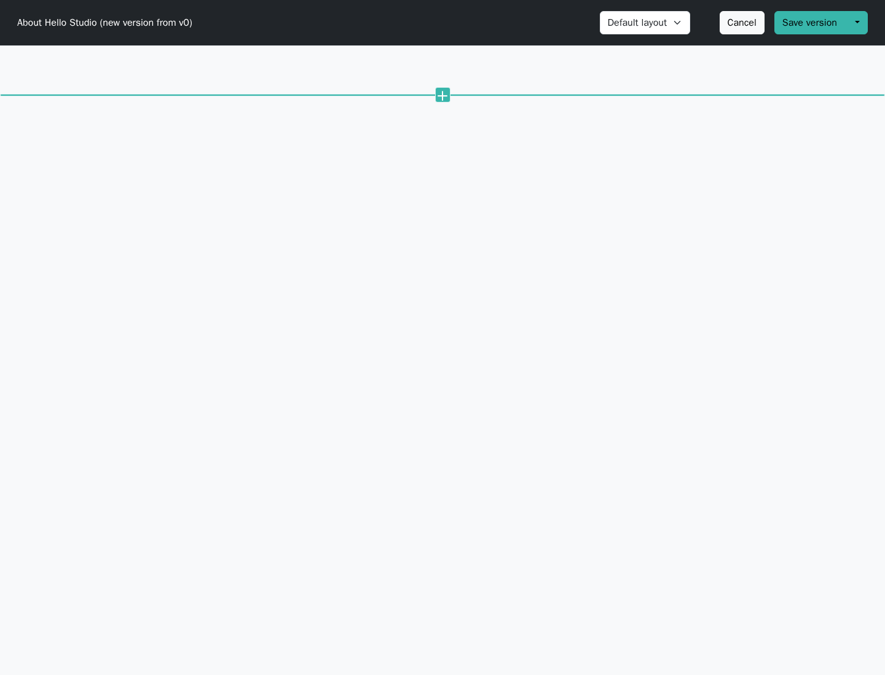
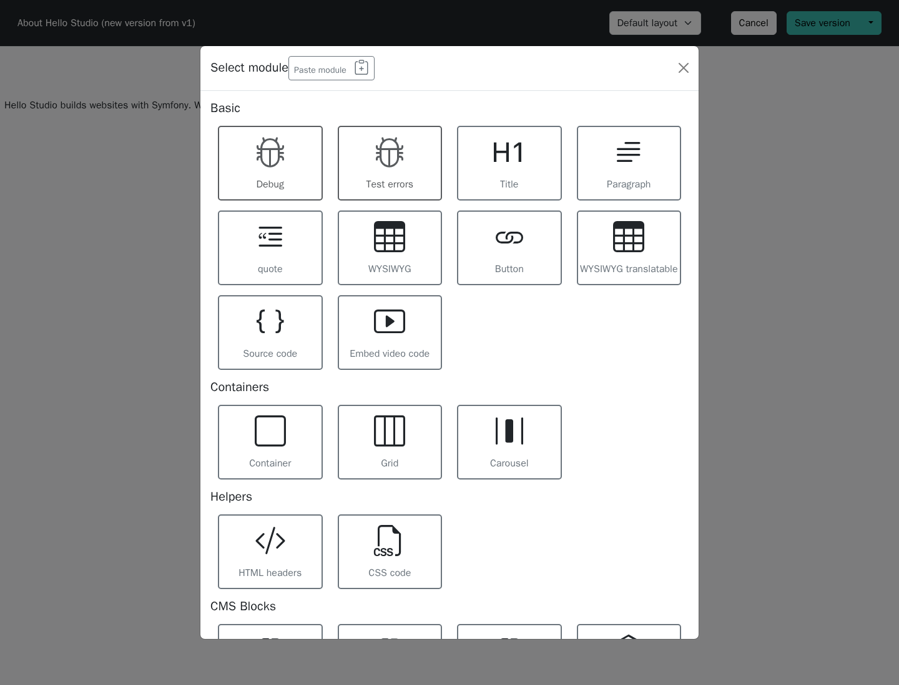
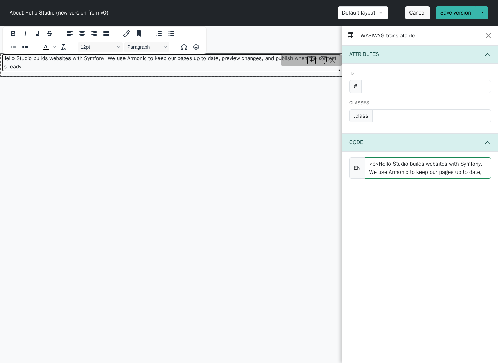

# Add modules or blocks to a page {#adding-modules-or-blocks-to-a-page}

Modules hold a page's editable content: headings, text, images, grids, or project-specific elements. A shared block holds content managed once and reused in several places.

The modules offered by the editor depend on the layout, content type, and project configuration. The screenshots show the standalone demo's translatable rich-text module.

## Open the content editor {#accessing-content-section}

Open **CMS / Pages**, find the page, and choose **Content**. You can also open **View** and use its **Content** tab.

Choose the version and layout you want to edit. A layout defines named areas such as `main`; each area can restrict the modules allowed inside it.

## Insert a module {#adding-modules-or-blocks}

Move the pointer over an editable area and use its insert control:

{.img-fluid}

Choose a module from the picker:

{.img-fluid}

Select the module in the page to open its settings. For a translatable text module, enter the content in every language enabled for the page.

{.img-fluid}

Common settings include:

- **Content fields:** the text, media, links, or other values defined for this module.
- **Language or site filters:** where the module appears, when the module provides these filters.
- **Attributes:** optional HTML identifiers or CSS classes for the site's existing styles.
- **HTML/code fields:** available only in modules designed for that purpose. Use them when you understand the resulting markup.

The editor preview helps with composition. Use the page preview before publishing to check the final layout and links.

## Insert shared content {#blocks}

To reuse an existing block, insert the **Block instance** module and select the block record. The name of this module can be customized by the application.

Create the record first under **CMS / Blocks** if it does not exist. Reusing the same record means that later block edits affect every page that renders it; copying a module's text into several pages creates separate values instead.

See [Create a block](create-a-new-block.md) for the full flow.

## Save and review {#save-and-review}

Use **Save version** to keep a draft, or its dropdown to choose **Save and preview**. Verify text, media, links, and each language. Publishing is a separate action; see [Preview and publish](preview-and-publish-a-page.md).

If a module is missing, ask a developer to check the layout restrictions and enabled module types. Adding a record in the CMS does not install a new module type.
