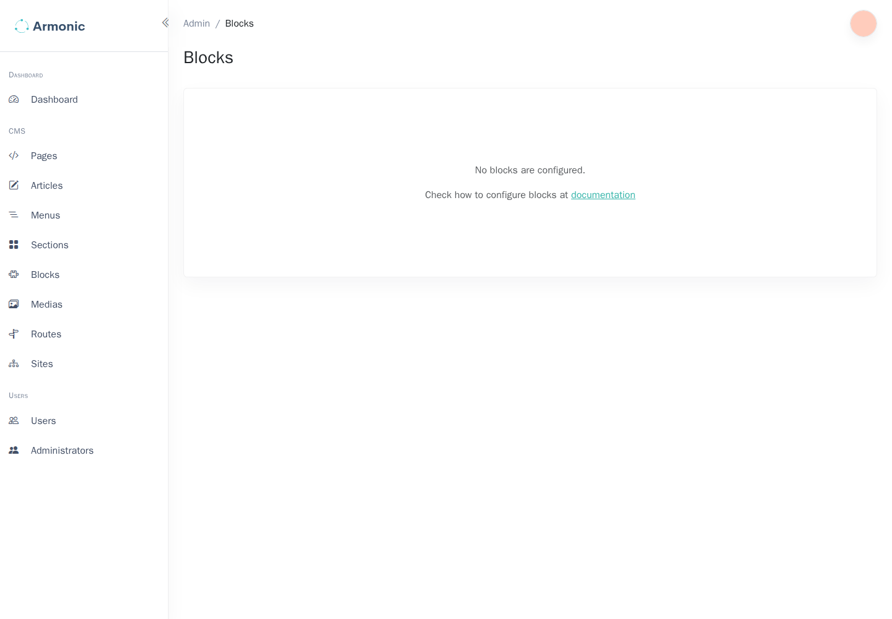
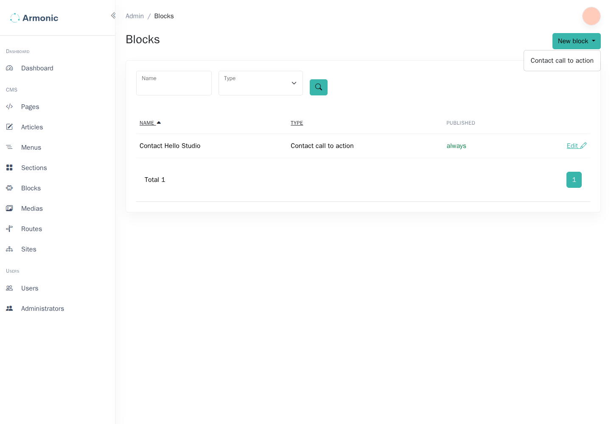
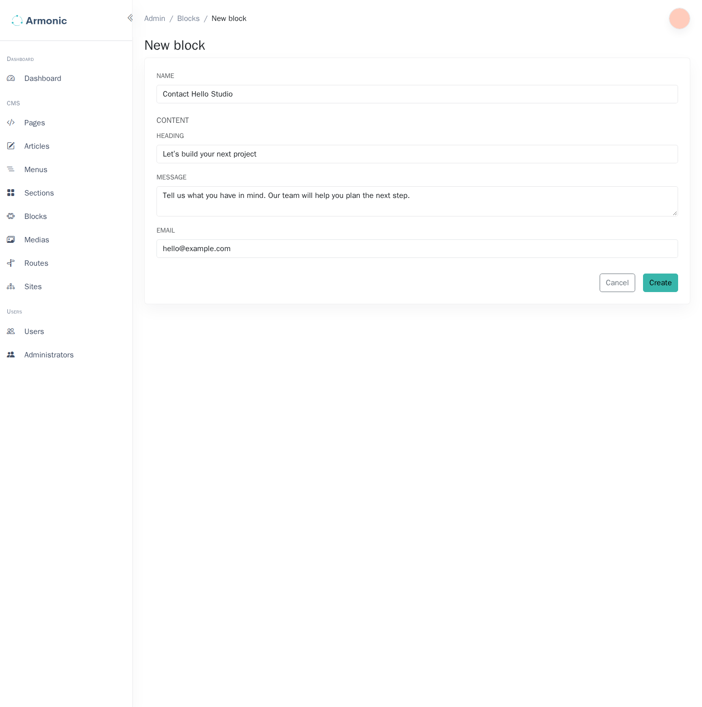
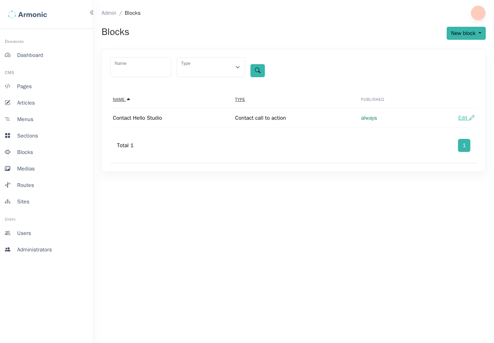

# Create a block {#creating-a-new-block-in-armonic-cms}

A block stores reusable content such as a contact invitation. When several pages use the same block record, editors can update that shared content once.

A developer must first define the available block types. If the creation menu has no suitable type, see [Configure blocks](../configuration/configure-blocks.md).

## Choose a block type {#accessing-the-block-creator}

Open **CMS / Blocks**, then **New block** and choose a type. The screenshots use the contact call to action from [Build a small website](build-a-small-website.md).

{.img-fluid}

{.img-fluid}

The list is defined by your application. A singleton type allows one record; a reusable type can allow several records with different data.

## Fill in the content {#filling-block-basic-information}

Give the block a recognizable internal name, such as **Contact invitation**, and complete the fields supplied by its type. For the example call to action, enter a heading, message, and contact email.

{.img-fluid}

Choose **Create**. Confirm that the new record appears in the list:

{.img-fluid}

## Use it in a page {#using-block-in-pages}

Open the page's content editor, insert **Block instance**, and select the record you created. Save, preview, and publish the page version.

Creating the record alone does not place it on a page. A developer can also render it directly from a Twig template.

When changing a shared block later, check every important page that uses it. Its edits are independent of page version history, so republishing an older page version does not restore an older block record.
