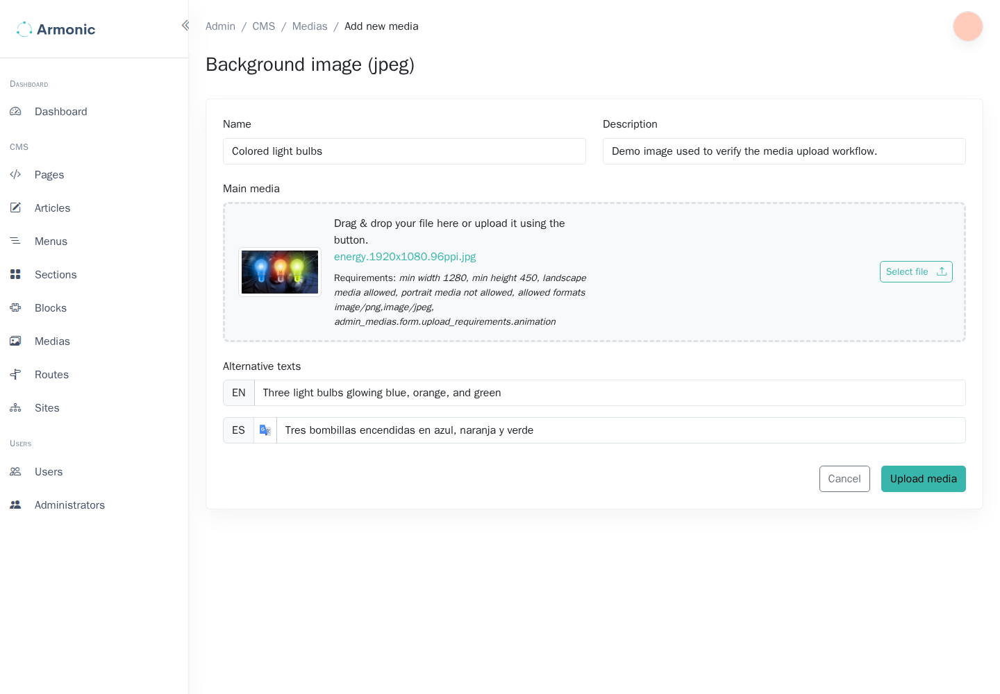
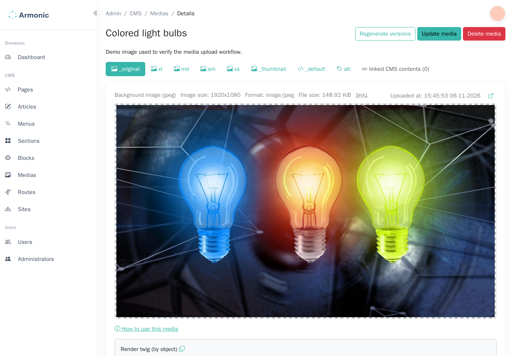

# Upload media {#create-a-new-media}

The media library stores the images and videos used by the site. Media types define the accepted files, upload requirements, and generated versions. The type names and available formats depend on your application.

## Upload a file {#upload-file}

1. Open **Medias** in the admin sidebar.
2. Choose **New media** and select a type appropriate to the file's intended use.
3. Enter a recognizable **Name** and a useful **Description**.
4. Select the original file in the upload field. Check the accepted formats, minimum dimensions, orientation, and size shown by the form.
5. Complete the alternative text for each language, if the form exposes these fields. Describe what the image communicates in its context.
6. Complete any additional uploads requested by that type and choose **Upload media**.



The bundle generates the configured derived versions from the original. Some types also request separately uploaded versions; do not assume that every upload field is generated automatically.

Use a description that identifies the image's purpose. The renderer can use it as fallback alternative text, but a template or translated alt-text field may override it.

## Review generated versions {#show-media-details}

Open the saved record from the media list. Review the original, generated versions, file details, and available rendering examples. Confirm that each required version exists before using the media in a page.



For example, a type might generate a small thumbnail and a larger image for page content. These are different files derived from the same original, not separate media records.

## Use the media in content {#use-media}

Open the relevant page module or block, use its media selection field, and choose the saved record. Preview and publish the page after making the selection.

A developer can also render a configured version from Twig:

```twig
{{ media|sfs_media_render_image('sm', {'class': 'img-fluid'}) }}
```

`sm` must be a version defined by that media type. A project using another version name must adapt the example. See [Media types](../bundles/media-bundle/media-types.md) for developer configuration.

If an upload is rejected, compare it with the selected type's requirements. If version generation fails, ask a developer to check the configured image driver, codecs, and processing services before retrying.
