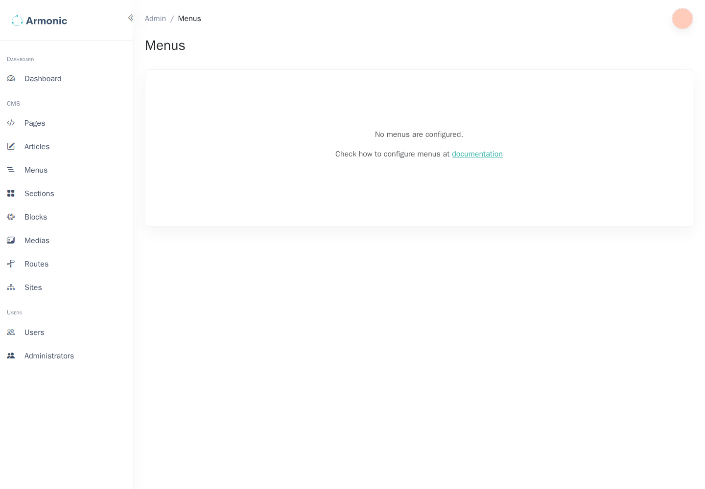
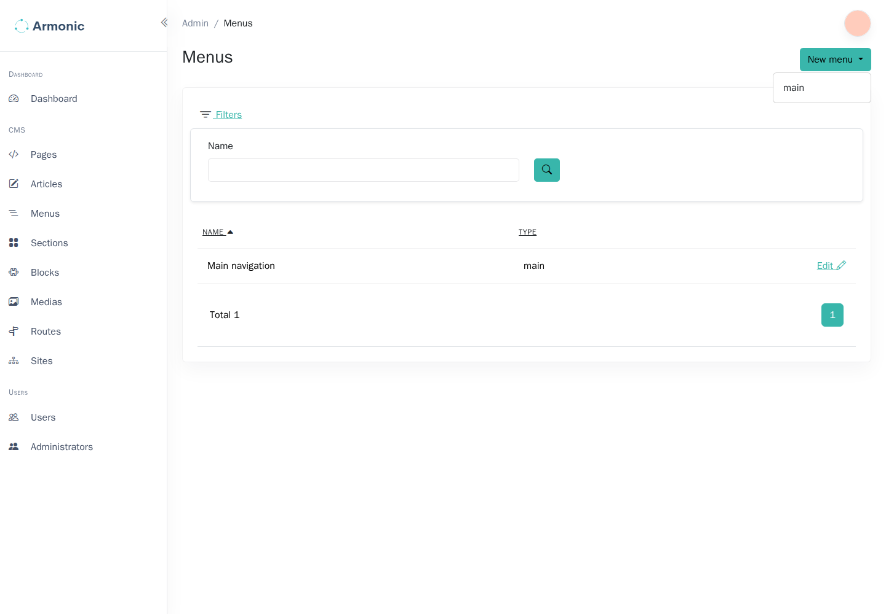
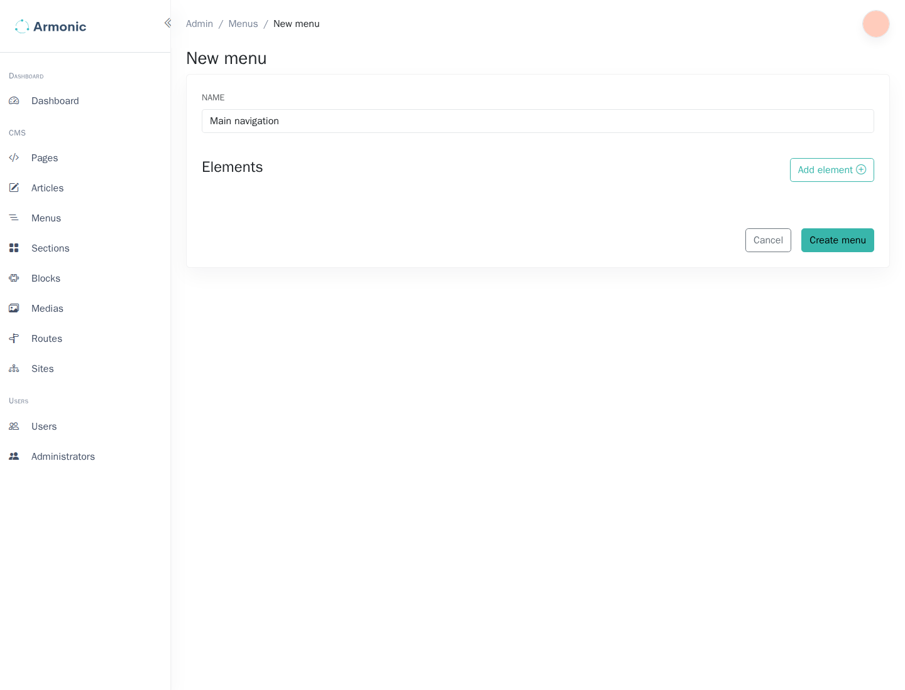
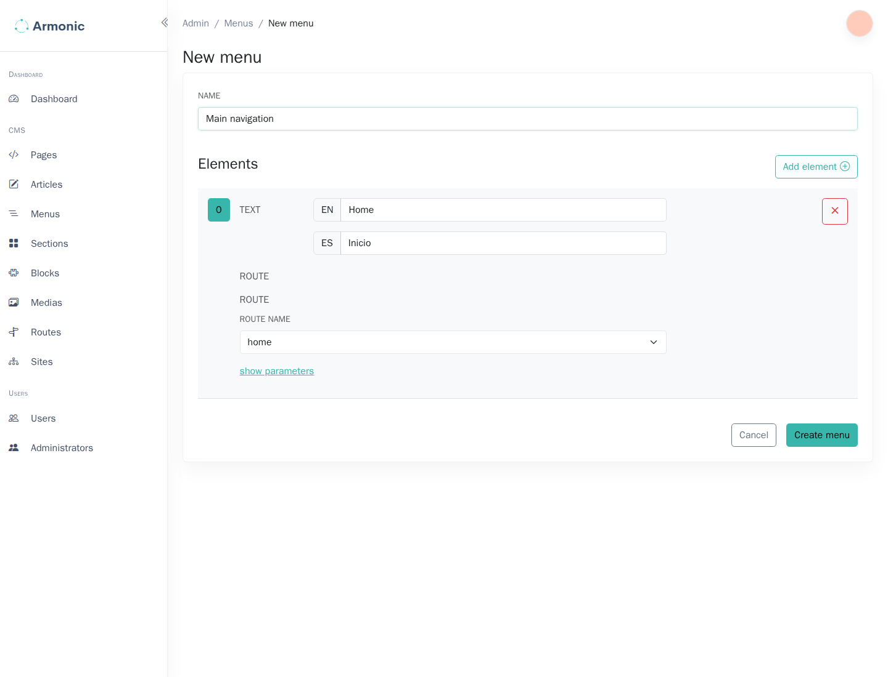
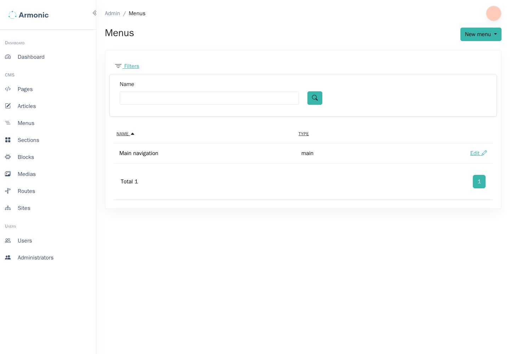

# Create a menu {#creating-a-new-menu-in-armonic-cms}

Menus organize links to pages, Symfony routes, or other supported destinations. A developer defines each menu type and places its rendering helper in the site layout; editors manage its items.

If the type you need is missing, see [Configure menus](../configuration/configure-menu.md).

## Choose the menu type {#accessing-the-menu-creator}

Open **CMS / Menus**, choose **New menu**, and select a configured type such as **Main**.

{.img-fluid}

{.img-fluid}

## Add labels and destinations {#filling-menu-basic-information}

Give the menu an internal name, such as **Main navigation**. Use **Add element** for each link:

{.img-fluid}

Enter the link text in the available languages and choose its route. Fill any route parameters required by that destination. For example, **About** can point to the `about` CMS route created with the page.

{.img-fluid}

Arrange the items in the intended order and choose **Create menu**. Confirm the result in the list:

{.img-fluid}

## Check the public navigation {#using-menu-in-pages}

Open a page whose layout renders this menu. Follow each link and verify its label in every enabled language. A menu item can refer to unpublished content, but visitors cannot use that page successfully until it is published.

Creating a menu record does not add it to a layout automatically. If it does not appear, ask a developer to check the menu type and the `sfs_cms_menu()` call in the page layout. The [small website walkthrough](build-a-small-website.md) includes both setup and editing steps.
