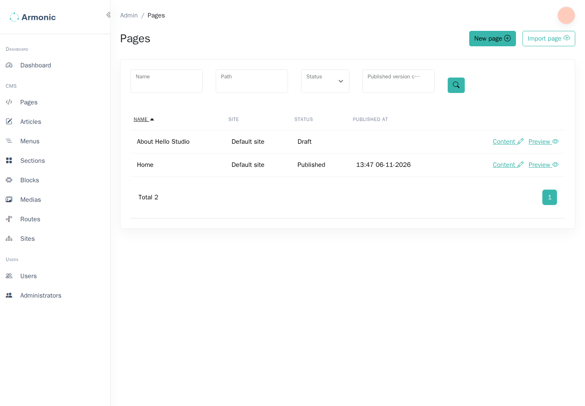
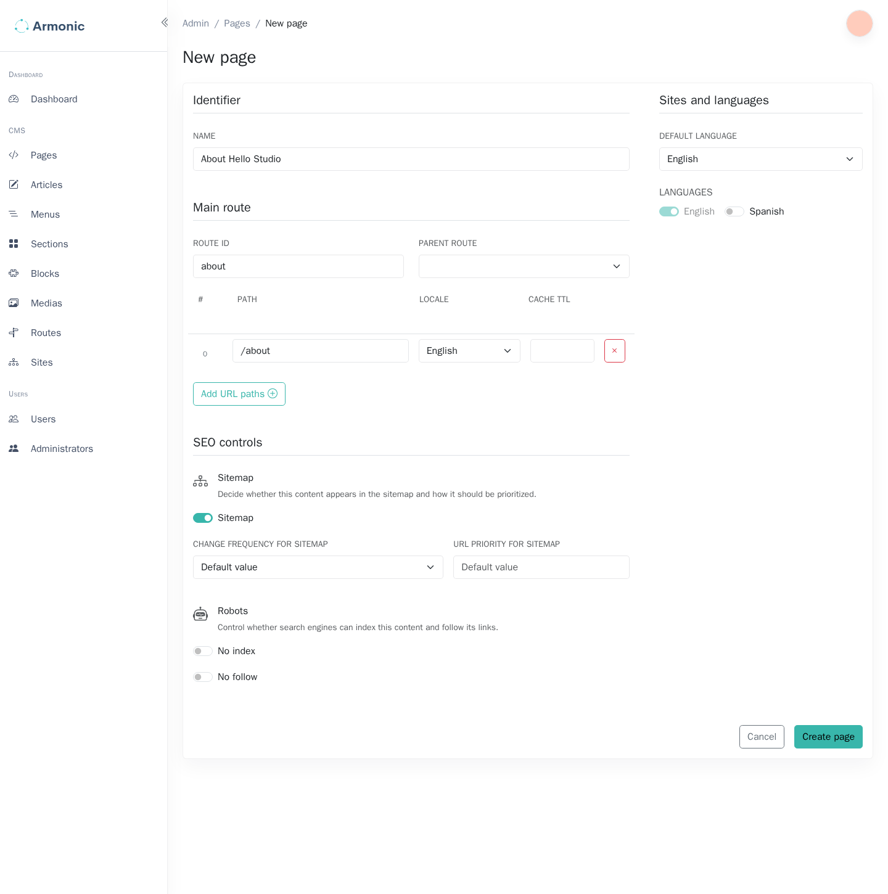

# Create a page {#create-a-new-page}

A page has an internal name, one or more public routes, and editable content versions. Creating it starts a draft; it does not publish the page.

The screenshots use the Armonic 6.0 standalone demo. Your application's page types, sites, fields, and available actions can differ.

## Open the page creator {#accessing-the-page-creator}

Open **CMS / Pages** in the sidebar, then choose **New page**.

{.img-fluid}

{.img-fluid}

## Enter the page details {#filling-basic-information}

For an About page, use an internal name such as **About**, a route identifier such as `about`, and a URL path such as `about`.

| Field | What to enter |
| --- | --- |
| Name | A name editors can recognize in lists. It does not automatically become the page heading. |
| Sites | The configured sites that can use this page, when this field is shown. |
| Route identifier | A unique internal route name used by menu links and templates. It is distinct from the public URL path. |
| Parent route | An optional parent used to organize nested URL paths. |
| Path | The page's path within the selected site's language path. |
| Default language | The primary language used by this page. |
| Additional languages | Other enabled languages for which editors will provide content. |

For example, `about` below an English site path `/en/` becomes `/en/about`. The page's displayed name and route identifier need not match this path. Keep the route identifier stable once other pages and menus refer to it.

{.img-fluid}

## Choose indexing options {#indexing-options}

- **No Index** asks search engines not to index the page.
- **No Follow Links** asks crawlers not to follow its links.
- **Add to Sitemap** includes the page in the configured sitemap. The frequency and priority are hints for crawlers.

These settings guide crawlers; they do not restrict access to a published page. Use your application's access controls for private content.

## Create the draft {#create-draft}

Choose **Create page**, then open the content editor if it is not opened automatically. Select a layout and [add modules or blocks](adding-modules-or-blocks.md).

Before publishing, review the route, each enabled language, and the SEO title. The page becomes available to visitors only after a content version is published.
