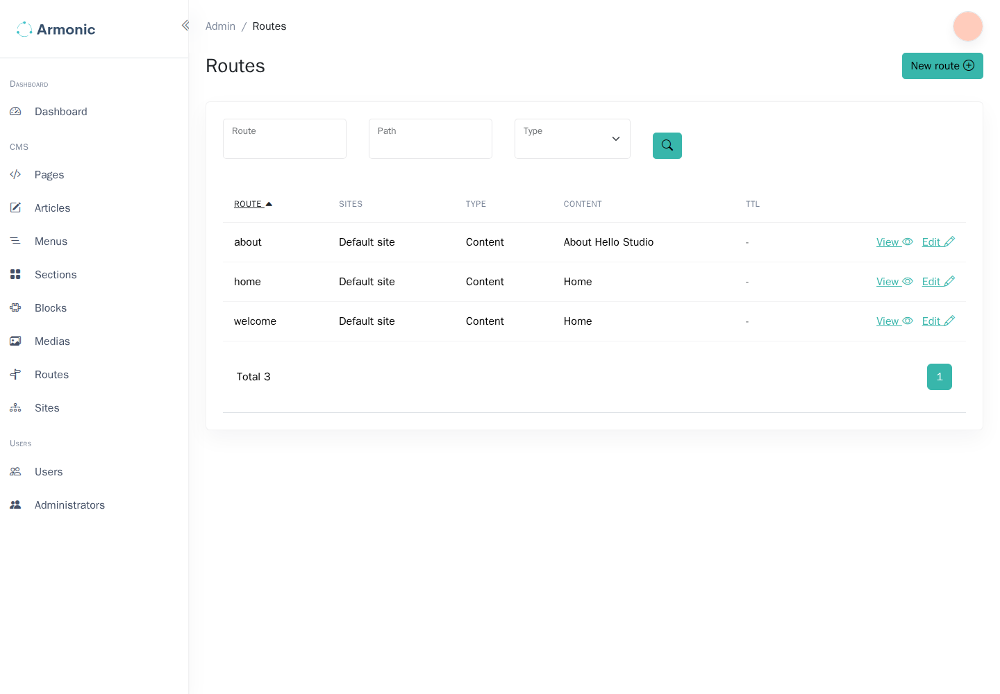
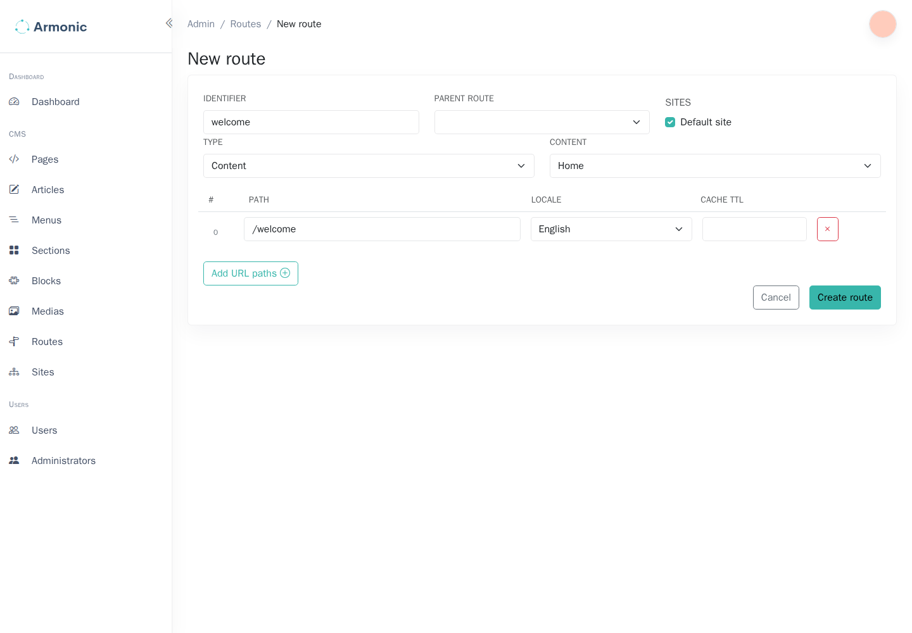

# Create routes {#create-routes-in-armonic-cms}

A CMS route connects a public path to content or a redirect. It has an internal identifier, site associations, and locale-specific paths.

Creating a page through **CMS / Pages** normally creates its route too. Use **CMS / Routes** when adding another path, setting up a redirect, or organizing a route hierarchy. Avoid creating a second route for a path already in use.

## Open the route creator {#accessing-routes-section}

Open **CMS / Routes** and choose **New route**.

{.img-fluid}

{.img-fluid}

## Configure the destination {#filling-route-information}

Choose a unique **Identifier**, such as `welcome`, and select the sites where the route applies. Identifiers begin with a letter and use letters, digits, or underscores; use at least four characters.

Select its **Type**:

| Type | Use it to |
| --- | --- |
| Content | Render a CMS content record. The content must belong to the selected sites. |
| Redirect to route | Redirect to an existing route, with its required parameters. |
| Redirect to URL | Redirect to a URL entered in the form. |
| Parent | Group nested routes without selecting a content record. |

For a content route, choose the page or content record. Add the public path for each required locale. For example, `/welcome` under a site's English `/en/` prefix produces `/en/welcome`.

{.img-fluid}

For a redirect, choose temporary or permanent behavior deliberately. A permanent redirect can be cached by browsers and search engines, making it less convenient while testing a destination.

## Save and test {#save-view-edit-route}

Choose **Create route**, then open the route from its list:

{.img-fluid}

Visit the public path on the matching host and locale. For content routes, verify that the target has a published version. For redirects, check the destination and ensure it does not redirect back to the same URL.

Changing a route affects menu items and links that refer to it. Review those links after changing or removing a route.
